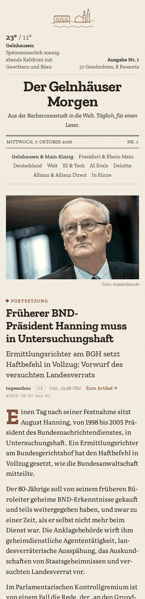
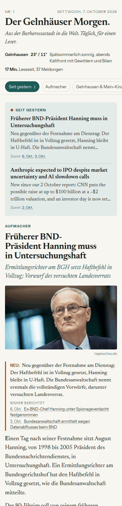
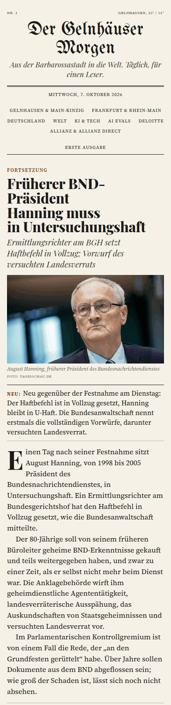
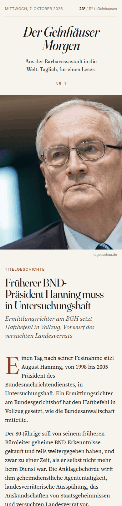
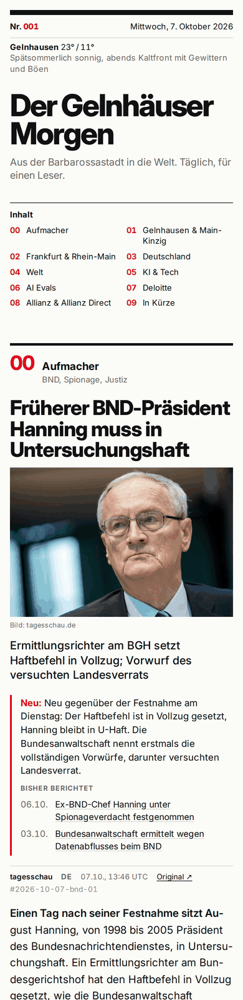
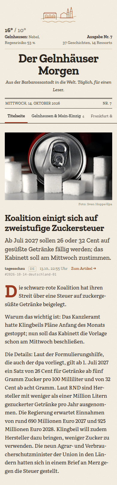

# News

A personal daily newspaper, built every morning as one self-contained HTML page
in a kasten vault and linked from that day's
daily note. Each story stays in its source language. Stories earlier editions
ran come back only when something new happened, as a follow-up that links the
earlier coverage.

## Skills

Each skill starts from its slash command or from a plain request ("build
today's edition", "less Polizeibericht"); cron runs `/news:edition`.

- `/news:edition [--vault PATH] [--date YYYY-MM-DD] [--periodic FOLDER]`: applies open feedback,
  gathers news per section (one subagent each where the host has them), drops
  repeats, writes, renders with the configured design, records what ran, and
  links the page from the daily note. Runs by hand or headless from cron.
- `/news:feedback "<text>"`: applies one piece of feedback to the config now
  and shows the diff. Story ids such as `#2026-10-07-evals-02`, printed small
  next to every story, let you say "more like" or "less like".
- `/news:tune`: an interview over sections, depth, sources, interests and
  design that rewrites the config, and can re-render today's edition in
  another design to compare.

## In the vault

Everything lives under `<periodic>/05 Newspaper/`, with the periodic folder
resolved as `skills/edition/SKILL.md` (`## Arguments`) says. The first run seeds what is missing
from `skills/edition/references/defaults/`:

```text
05 Newspaper/
  config/topics.yaml     style, sections, queries, sources, depth, freshness, interests, avoid
  config/design.yaml     design, title, tagline, colour and font overrides
  feedback.md            your feedback note: write under "## Open"
  memory/stories.jsonl   every story that ran, the record dedupe checks against
  memory/changelog.md    every config change made from feedback
  memory/source-failures.md  sources that failed, so a second failure blocks them
  2026-10-07.html        an edition
  2026-10-07.json        the data it was rendered from; re-render any time
```

The daily note gets one line above its first heading:
`Zeitung: [[01 Periodic/05 Newspaper/2026-10-07.html]]`.

The page cannot write anything (kasten's HTML pane blocks network calls), so
feedback goes into `feedback.md`, from any device. Each edition applies what is
under `## Open`, moves it to `## Applied` with what changed, and shows the
three newest changes in its footer.

## Designs

Six designs ship with the plugin, plus `plain`, the fallback used when the
configured design is not installed. Pick one with `design:` in
`config/design.yaml`, or run `/news:tune`, which can render today's edition in
each design side by side. Colours and fonts change through `overrides:` in the
same file.

| Design                  | Look                                                                    |
| ----------------------- | ----------------------------------------------------------------------- |
| `heimatblatt` (default) | Warm local paper from the Kinzig valley; the home section framed green. |
| `briefing`              | One calm reading column with a sticky index; follow-ups gathered first. |
| `broadsheet`            | German print front page: Fraktur masthead, columns, hairline rules.     |
| `magazine`              | Weekend supplement: full-bleed lead, big numerals, scale by importance. |
| `swiss`                 | Strict 12-column grid in Inter with one signal red.                     |
| `tabbed`                | The heimatblatt look with one tab per section instead of one scroll.    |

<p>






</p>

Each design lives in `skills/edition/designs/<name>/` as `template.html.j2`
(some with included parts beside it) with a `NOTES.md`; the contract they render is
`skills/edition/references/edition-contract.md`, and
`skills/edition/designs/README.md` says what a design must do.

## Network

Gathering reads the web through `WebSearch`, `WebFetch` and `curl`, which is
the job you ask for. The scripts make two requests of their own:
`weather.py` asks Open-Meteo (free, no key) for the day's forecast at
topics.yaml's `weather` point, and only while an edition is being built and
its weather is still empty. Set `weather: null` in topics.yaml to turn it off.
`tables.py` fetches the league tables a section lists under `tables:` from
sportschau.de, also only while an edition is being built.

## Setup

Needs `uv` (the scripts are Python with inline dependencies) and the host
agent's web tools: `WebSearch` and `WebFetch` in Claude Code; in Codex and
Cursor, their own web search tool and `curl`. To get a paper every morning,
have cron run the wrapper at 06:00 Europe/Berlin with the vault path:

```text
0 6 * * * /path/to/plugins/news/scripts/cron-edition.sh /path/to/vault
```

The wrapper runs
`claude -p "/news:edition --vault <vault> --periodic <periodic> --date <today>"`
with `--dangerously-skip-permissions`, since nobody is there to answer a
prompt. It logs to `~/.local/state/news/<date>.log` (`NEWS_LOG_DIR` changes
that; `NEWS_PLUGIN_DIR` loads the plugin from a working tree to test a
change), and exits non-zero when claude fails or no edition was written.
`KASTEN_PERIODIC_PATH` names the periodic folder (`01 Periodic` when unset);
the wrapper passes it to the skill and looks for the page there. Cron uses
the host's time zone; on a host not set to Europe/Berlin, add
`CRON_TZ=Europe/Berlin` above the line.

## Tests

`tests/run.sh` needs `uv` and `python3` and runs in about two seconds. The
scripts under test open no outside connection; `uv` may fetch pyyaml once. It checks three things:

- The cron wrapper, with a fake `claude` in a temp home and a temp vault: it
  skips permissions, passes the folder from `KASTEN_PERIODIC_PATH` as
  `--periodic`, looks in `01 Periodic` when the variable is unset, and exits 1
  when no page was written.
- `validate.py` on fixture editions in `tests/fixtures/`: it passes dates
  inside the section's `freshness_days` (a bare day and a datetime with an
  offset), fails a story older than the window and one dated after the
  edition, reading `config/topics.yaml` beside the edition by default, and
  only warns when there is no topics.yaml.
- `refetch.py`, against a closed port and a local server
  (`tests/fixtures/server.py`): a closed port and a 404 fail as dead (exit 1),
  a 403 fails as a refusal (exit 2), a page prints its text without the
  script, and a paywalled page prints its `og:description`.

Last run, 2026-10-19: 25 of 25 checks pass.

The skills' judgement steps have no test.

## Evals

`evals/` holds 12 cases that test which skill a prompt triggers. Cases 01 to 03 give one trigger case per skill: `edition`, `feedback` and `tune`. Cases 21 to 23 are negatives: each checks that none of the three skills fires. Cases 31 to 36 are near-misses, one per ordered pair of skills: each prompt borrows the words of one skill and belongs to another. Between `feedback` and `tune` the prompt's scope decides: one stated change goes to `feedback`; a walk through the settings, a list of designs or a comparison of designs goes to `tune`.

No news skill calls another through the Skill tool. `tune` re-renders through `../edition/scripts/render.py` with Bash, `feedback` tells the user to run the build themselves, and `edition` applies open items from the vault's feedback note itself. The runner allows no Bash either. The graders match the full names `news:edition`, `news:feedback` and `news:tune`, so a skill's name quoted in a call's args does not match a sibling's grader.

No one has run the suite yet; a run costs money, so the user decides when. Run from `plugins/news`:

```bash
claude plugin eval . --trust-plugin --tag core --runs 1 -j 4 --max-cost-usd 10 --no-publish
```
