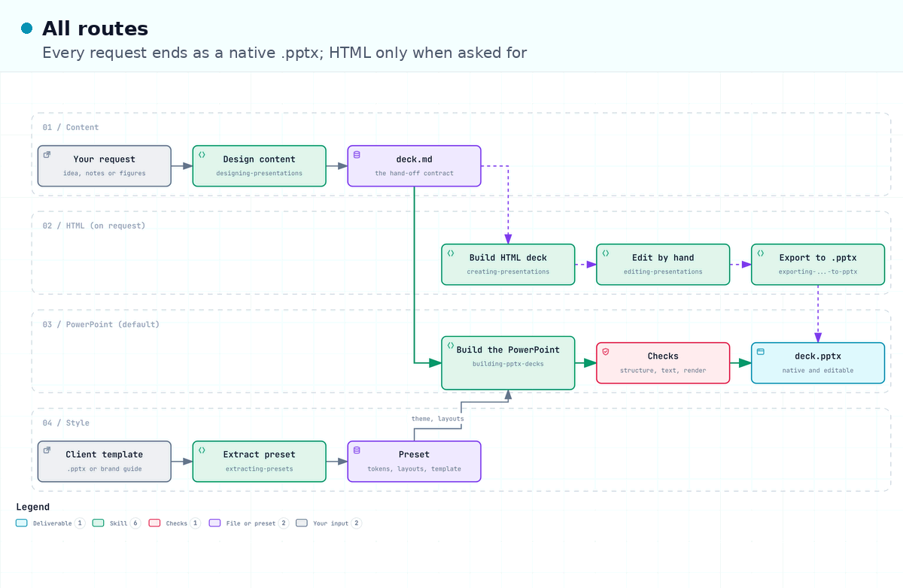

# presentations

Skills covering the full presentation lifecycle: content design, native PowerPoint decks (the default), HTML decks with an integrated perfecting loop and presenter view, a local deck editor, PowerPoint export of HTML decks, and brand preset extraction.



The diagram's source is [diagrams/routes.workflow.json](diagrams/routes.workflow.json), drawn with `/diagrams:creating-diagrams`; deliver it again to get the interactive HTML viewer.

## Skills

| Skill                             | What it does                                                                                                                                                                                                                        |
| --------------------------------- | ----------------------------------------------------------------------------------------------------------------------------------------------------------------------------------------------------------------------------------- |
| `designing-presentations`         | Content design from sourced audience brief through competing storylines and written checks. Produces a `deck.md`; no rendering.                                                                                                     |
| `building-pptx-decks`             | Builds a native, structured PowerPoint (theme, layouts, placeholders, native charts) from a `deck.md` or content and a preset, fills a client template, or edits an existing `.pptx` in place. The default when no format is named. |
| `creating-presentations`          | Builds multi-slide HTML decks styled from a preset, with a deck-stage engine, a two-window presenter view, default render checks, and an opt-in review loop.                                                                        |
| `editing-presentations`           | Runs a local editor on a deck: click slide elements and type a note, and the agent reads the selection with slide, selector, and source lines.                                                                                      |
| `exporting-presentations-to-pptx` | Converts a finished HTML deck into native, editable PowerPoint (real text boxes, autoshapes, embedded images, speaker notes).                                                                                                       |
| `extracting-presets`              | Turns brand material (PPTX templates, PDF guidelines, example decks) into reusable presets: CSS variables, assets, icon libraries, example slides.                                                                                  |

The typical flow: `designing-presentations` writes `deck.md`, then `building-pptx-decks` builds it as PowerPoint. When the user asks for HTML, a browser deck, or the presenter view, `creating-presentations` renders and perfects an HTML deck instead, `editing-presentations` opens it for changes by hand, and `exporting-presentations-to-pptx` converts it to PowerPoint later. A bare ask for a deck, with no `deck.md`, storyline, or content, starts at `designing-presentations`, which asks for the material first; an ask with a `deck.md`, a settled storyline, or its own content goes straight to the builder.

## Presets

Styling flows through presets, packs of CSS variables, guidance files, assets, and example slides. The full contract lives in [presets/README.md](presets/README.md). Two homes:

- **Bundled**: `presets/` in this plugin. Ships with the plugin; seven presets, each with vendored open fonts, a `language.md` style contract, the shared chart token group, and its own layout grammar (grid tokens in `colors.css`, a `## Layout grammar` section in `guidelines.md`, and a gallery of nineteen or more slides built to it, each tagged by role, move, and form in `slides/index.tsv` under the vocabulary in [presets/TAGS.md](presets/TAGS.md), and a `README.md` with rendered previews to browse on GitHub):
  - `default`: the quiet direction (off-white, one green accent, Figtree) with the full proof-object gallery. The fallback when nothing else fits.
  - `analytical`: claim plus number for decks read by or presented to decision makers (white, navy, blue accent, IBM Plex Serif and Sans).
  - `keynote`: one idea per slide for stage talks, dark by default (Inter).
  - `product`: short declaratives for launches and engineering all-hands (near-achromatic, signal orange, Geist).
  - `editorial`: sentence headlines and newsroom chart grammar for data stories and readouts (tinted paper, claret, Newsreader and Source Sans 3).
  - `workshop`: invitational titles for training and mixed or low-vision audiences (warm paper, teal, Fraunces and Atkinson Hyperlegible Next).
  - `technical`: dense diagrams, code, and tradeoff tables for engineering deep dives, architecture reviews, design docs presented live, and incident reviews; dark first (graphite, amber path highlight, Red Hat Display, Text, and Mono).
- **Local**: `.pgoell/presentations/presets/<name>/` at the root of the repo you are working in. User-owned, created by `extracting-presets`, never shipped. A local preset made from a client PowerPoint template keeps that template under `pptx/`, and `building-pptx-decks` fills it instead of drawing the deck from the tokens.

Preset selection: an explicit prompt choice wins; otherwise `.pgoell/presentations/config.md` (`## Preset` section with `Name:` or `Path:`); otherwise the single local preset (a question when several exist); otherwise the bundled preset that fits the deck's use, named with its reason, with `default` as the fallback.

```markdown
<!-- .pgoell/presentations/config.md -->

## Preset

Name: acme-corp
```

## Runtime dependencies

No install-time setup. At runtime the skills reach for tools when a branch needs them: Node with `pptxgenjs` (building and exporting PowerPoint), a Chromium-based browser (presenting, editing, measuring, headless screenshots), Python 3 (the deck editor's server and the standard-library PowerPoint tools), `uv` (ad hoc Python for PDF and image work and a local HTTP server), and LibreOffice, local or in a container (rendering PowerPoint files for checks). Each skill degrades gracefully and says so when a tool is missing.
