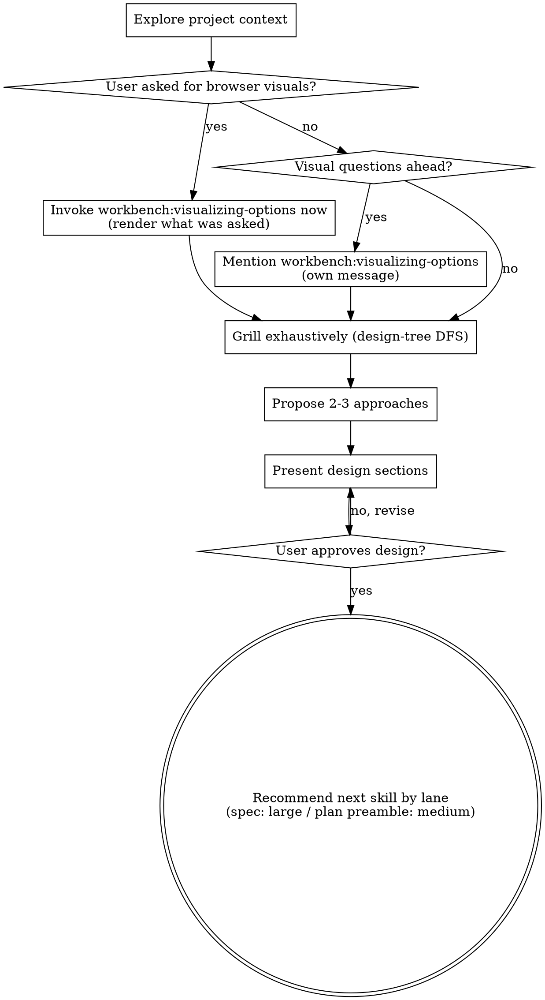

# Brainstorming Ideas Into Designs

Help turn ideas into well-formed designs through natural collaborative dialogue.

Start by understanding the current project context, then ask questions one at a time to refine the idea. Once the design is clear and the user approves, hand off by lane: `workbench:writing-spec` in the large lane, or `workbench:writing-plans` in its Design-preamble mode in the medium lane.

<HARD-GATE>
Do NOT invoke any implementation skill, write any code, scaffold any project, or take any implementation action until you have presented a design and the user has approved it. This applies to EVERY project regardless of perceived simplicity.
</HARD-GATE>

## Lane scaling

Lane routing happens before this skill is invoked (see `workbench:using-workbench`). The quick lane never enters this skill. This skill serves two lanes:

- **Medium lane:** a few targeted questions, converging quickly on the decisions that feed the combined doc's `## Design` preamble.
- **Large lane:** full depth-first grilling toward a spec, as described below.

The HARD-GATE above applies within both the medium and large lanes: no implementation until the design, however short in the medium lane, is presented and approved.

## Checklist

You MUST create a task for each of these items and complete them in order:

1. **Explore project context**: dispatch a cost-efficient subagent to survey files, docs, and recent commits; use its summary as starting context.
2. **Visualizing-options**: if the user's request explicitly asks to see, render or click options in the browser ("show me three layouts in the browser", "mockups I can click in the browser"), that request is the opt-in: invoke `workbench:visualizing-options` in this same turn and render what they asked for, with no offer message. Otherwise, if the topic will involve visual questions, offer it: mention `workbench:visualizing-options` in its own message, pointer only; the user opts in.
3. **Grill exhaustively until a shared design concept emerges**: walk the design tree depth-first, resolving each branch's dependencies before moving to the next.
4. **Propose 2-3 approaches**: with trade-offs and your recommendation.
5. **Present design**: in sections scaled to their complexity, get user approval after each section.
6. **Recommend the lane's next skill** as the terminal step: `workbench:writing-spec` in the large lane (spec doc, self-review, approval gate), or `workbench:writing-plans` in its Design-preamble mode in the medium lane (combined doc).

## Grilling toward a shared design concept

Two minds building together share an invisible theory of the system: the design concept (Brooks, _The Design of Design_). The conversation surfaces it, questions strip away ambiguity, and the artifact at the end is a record of the conversation, not its purpose.

**Walk the design tree depth-first.**

Treat the design as a tree. The root is "what are we building, and why." Branches resolve to dependent decisions: which approach, which boundaries, which interfaces, which failure modes. Leaves are the decisions themselves. Pick one branch, follow every dependency to a decision, only then return to the next branch. Do not breadth-first a checklist of section headings.

**Order branches by decision leverage.**

When choosing which branch to walk next, pick the one whose answers could invalidate the most other decisions: architecture and approach first, then boundaries and interfaces, then failure modes, then cosmetic or easily reversed details last. One question that could change the architecture is worth more early than ten leaf questions answered under an architecture that might not survive. If a later answer reveals that an unwalked branch invalidates decisions already made, jump to that branch immediately and revisit the affected leaves afterward.

**Ask for reference artifacts early.**

Within the first few questions, ask once whether the user can point at reference artifacts: existing code in this or another repo (even another language), an HTML mockup, a similar feature in another system, an API to mirror. If they name one, read it completely before the next question, then play back what you took from it: what to imitate, what to diverge from, what to omit. Treat the artifact as the answer to every design-tree branch it settles and spend the remaining questions only on the deltas. Record each artifact's path or URL in the Q and A record so the brainstorm summary and the downstream spec can cite it.

In autonomous runs where the user is not present (for example in a gateless `workbench:pilot` run), substitute a search for the ask: extend the checklist-item-1 exploration subagent's prompt with "also report the closest existing implementation of anything similar in this repo, with paths", and read what it finds before self-answering.

**Take an adversarial posture.**

Probe for unstated assumptions, latent constraints, and edge cases the user has not considered. When the user gives a short answer, ask the obvious next question even when the answer feels implied. Treat the user as the source of truth about what they want and treat yourself as the source of skeptical pressure on whether they have said it clearly.

**Stop only when both are true:**

1. You cannot think of a question whose answer would change the design.
2. The user can re-state the design concept back to you in their own words.

Do not stop at "I have enough to write the downstream doc" (the spec in the large lane, the combined doc's `## Design` preamble in the medium lane). A numeric question minimum is not the rule; depth and convergence are.

**Scale to scope.**

The lane-scaling carve-out still applies. A medium-lane question set might converge in three questions. A new subsystem will not. Trust the design tree to tell you when there is more to ask. In autonomous runs where the user is not present (for example in a gateless `workbench:pilot` run), substitute the second stop-rule clause with "the self-answered Q&A converges on a `## Decision` block whose design concept covers every branch you walked."

## Process Flow

## The Process

**Understanding the idea:**

- Delegate project-state exploration to a cost-efficient subagent (Claude Code: `Explore` agent type, haiku model. Codex: read-only research agent equivalent. Cursor: `Task` with the built-in Explore subagent, which uses a faster model by default.) Pass a tight prompt: "Survey this repo. Report under 250 words: primary language, top-level structure, recent commits (last 5), presence of CLAUDE.md/AGENTS.md/README, any docs/ directory worth reading. Don't list every file." Use the returned summary as your starting context.
- Before asking detailed questions, assess scope: if the request describes multiple independent subsystems, flag this immediately. Do not spend questions refining details of a project that needs to be decomposed first.
- If the project is too large for a single spec, help the user decompose into sub-projects. Each sub-project then gets its own brainstorm and spec cycle.
- For appropriately scoped projects, ask questions one at a time.
- Ask once, early, for reference artifacts; a named artifact replaces prose answers for every branch it settles. See **Ask for reference artifacts early** above.
- Prefer multiple choice questions when possible.
- One question per message.
- Focus on understanding: purpose, constraints, success criteria.
- See **Grilling toward a shared design concept** above for the depth-first design-tree protocol; the rules in this list are the mechanical rhythm.

**Exploring approaches:**

- Propose 2-3 different approaches with trade-offs.
- Before presenting two desirable properties as an either/or, name the constraint that forces the choice: a design-level mutual exclusion, an external dependency, or a hard runtime, budget, or compatibility limit. Implementation effort alone is not a forcing constraint; if you cannot name one, the trade-off is assumed, not real.
- When the options differ only in implementation effort, include the combined approach as one of the 2-3, priced concretely (files touched, tests added, latency, maintenance surface) so the user can decline it knowingly. YAGNI still governs unrequested features; this rule protects scope the user asked for from being cut on an assumed cost.
- Lead with your recommendation and explain why.

**Presenting the design:**

- Scale each section to its complexity.
- Ask after each section whether it looks right so far.
- Cover: architecture, components, data flow, error handling, testing.
- Be ready to clarify if something does not make sense.

**Design for isolation and clarity:**

- Break the system into smaller units, each with one clear purpose, communicating through well-defined interfaces.
- Smaller, well-bounded units are easier to reason about. When a file grows large, that is often a signal it is doing too much.

**Working in existing codebases:**

- Delegate exploration of the area you are touching to a cost-efficient subagent. Follow the returned conventions.
- If the user says they do not know the area, relay the survey's conventions, gotchas, and dead ends to them before the first design question, so their answers are informed. For a standalone pre-work pass outside a design conversation, see `learning:surveying-blind-spots`.
- Where existing code has problems that affect the work, include targeted improvements as part of the design.
- Do not propose unrelated refactoring.

## Visual Questions

If the user has already asked for browser visuals, that ask is the opt-in: invoke `workbench:visualizing-options` in this same turn and render what they asked for, with no offer message. "Asked" means the user explicitly asks to see, render or click options in the browser. A UI topic alone is not an ask, nor are mockups the user calls out of scope or does not want; then the offer below applies. Rendering options through visualizing-options is design conversation, not implementation, so the HARD-GATE does not block it. After the render, carry on grilling from the user's choice.

Otherwise, if the conversation will involve visual content (mockups, layouts, diagrams), mention `workbench:visualizing-options` in its own message before asking the next question. The user opts in by acknowledging. That skill owns the browser companion; this skill stays in the terminal.

The offer message should contain ONLY the pointer; do not combine it with clarifying questions.

If the user stalls on a visual question ("I don't know", "whatever looks good"), stop rephrasing it in words. Use `workbench:visualizing-options` to render 3-4 deliberately divergent directions the user can react to instead of describe. If the companion is not yet running and the user has already asked for browser visuals, render now with no offer. Otherwise make the offer at that moment (same rule: own message, pointer only) and render once the user opts in.

## Handoff

Once the user has approved the design, your terminal action is to recommend the lane's next skill: `workbench:writing-spec` in the large lane, or `workbench:writing-plans` in its Design-preamble mode in the medium lane. Do NOT invoke any implementation skill and do NOT write the downstream artifact yourself. In the large lane the spec skill runs its self-review and gates on user approval before handing off to `workbench:writing-plans`.

The conversation itself is the handoff payload; the summary file is a record, not the interface between skills.

## Key Principles

- One question at a time.
- Multiple choice preferred.
- Depth-first grilling: walk the design tree, do not breadth-first a checklist.
- Highest-leverage branches first: architecture-changing questions before detail questions.
- YAGNI ruthlessly.
- Explore alternatives.
- Incremental validation.
- Be flexible: go back and clarify when something does not make sense.

## Output Format

Default for this artifact: **html**.

Override resolution order, highest precedence first:

1. Per-invocation override in the user prompt. Recognize phrases like `"a markdown brainstorm summary"`, `"in HTML"`, `"as a markdown summary"`, and equivalents.
2. `.workbench/config.md` `## Output formats` entry for `Brainstorm summaries:`. Schema documented in `plugins/workbench/skills/pilot/references/config-schema.md`.
3. Per-skill hard-coded default (html).

Path: `.workbench/brainstorms/YYYY-MM-DD-<topic>-brainstorm.<ext>` by default, where `<ext>` resolves from format. Override path via `.workbench/config.md` `## Output paths` `Brainstorm summaries:`.

When emitting HTML, follow `references/brainstorm-summary-template.html` in this skill's directory. Read the template lazily.

## Summary File Behavior

Once the user has approved the design, record the conversation by writing a brainstorm summary file to the resolved path. The file is a record kept after agreement, not the purpose of the skill. The summary captures:

- Q and A timeline of clarifying questions and user answers.
- Agreed design (sections approved during the conversation).
- Parking-lot items (deferred topics).
- Handoff link to the next step (writing-spec in the large lane, writing-plans in the medium lane).

Announce the file path in the conversation when emitting (for example: "Brainstorm summary written to `.workbench/brainstorms/2026-05-08-html-artifacts-brainstorm.html`") so the user is not surprised. The lane-appropriate handoff recommendation then follows in the same final message.

For other HTML artifact types not covered by a workbench or research skill, see `workbench:crafting-html`.

### Applying a design system

Before emitting HTML, check whether a design system is set: a per-prompt override (e.g., "render with the `brand-2026` design system"), else `.workbench/config.md` `## Design system` `Name:`. If one is set, read `../crafting-design-systems/references/applying-a-design-system.md` and follow it. If none is set, emit with the template's defaults.

To create or edit a design system, see `workbench:crafting-design-systems`.
